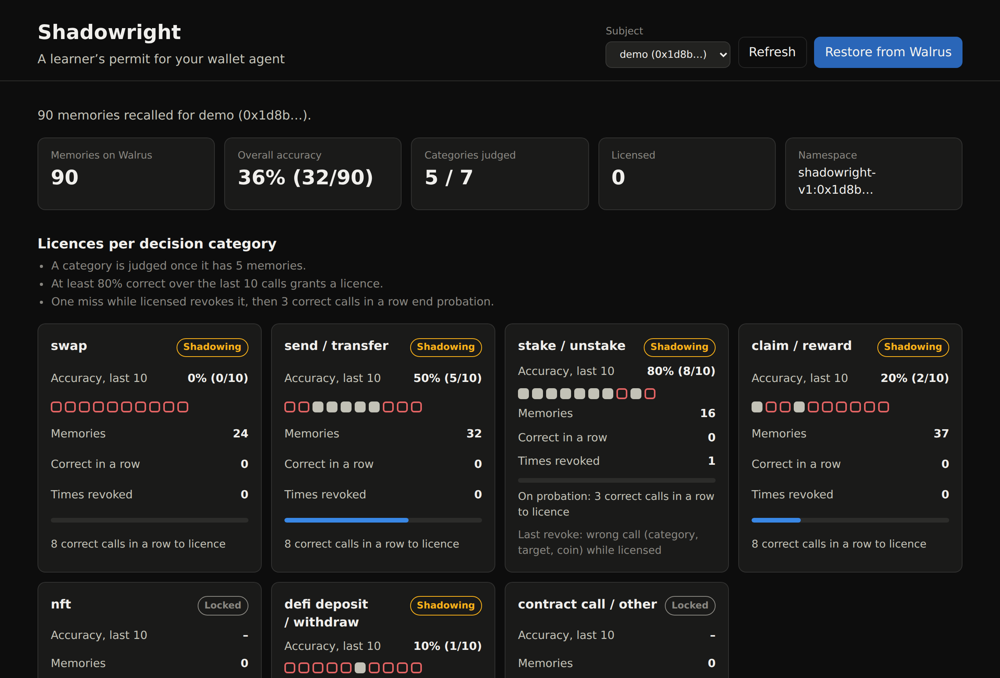
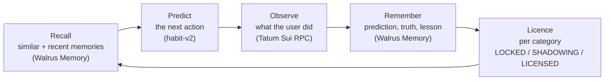
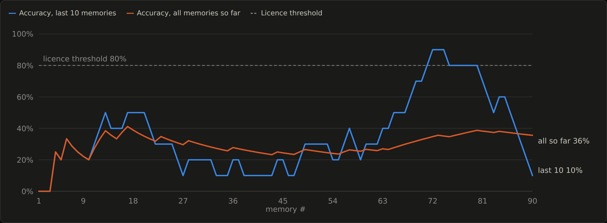
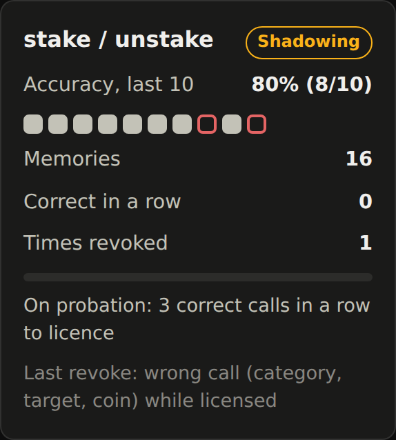
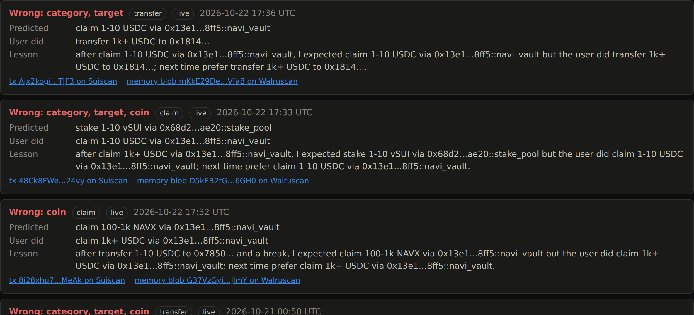
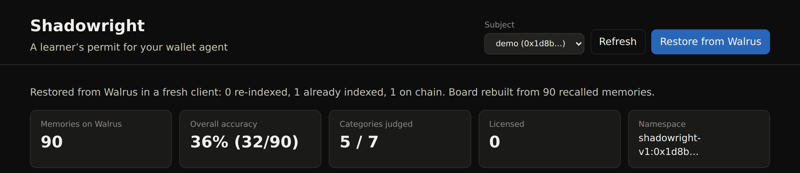
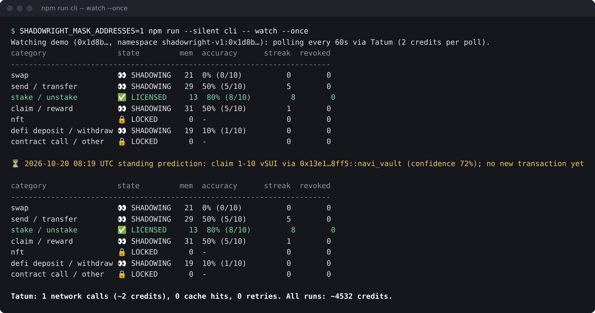

# Shadowright

**A learner's permit for your wallet agent.**

Wallet agents today ask for all-or-nothing access: either you sign every transaction yourself,
or the agent can do anything with every coin from day one. Shadowright makes the agent *earn*
autonomy instead, one decision category at a time (swaps, sends, staking, claims, ...).

**In 30 seconds.** Before each of your on-chain decisions on Sui, the agent privately predicts
what you will do. It then reads what you actually did through **Tatum**'s Sui RPC, and stores the
episode (context, prediction, truth, verdict and a lesson) in **Walrus Memory**. Before the next
decision it recalls those memories, and they are all it knows about you. Accuracy recalled from
Walrus decides, per category, whether the agent holds a licence. A licensed agent may act alone,
but only after a dry run, and it never signs. One wrong call revokes the licence.



*The Licence Board on a real public mainnet wallet (address masked): 80 memories on Walrus,
39% overall accuracy, stake / unstake licensed, everything else still shadowing.*

**Demo video (2:46):** https://youtu.be/kr0DQE7RSKQ · **Write-up:** [docs/BLOG.md](docs/BLOG.md)

## The loop



| State | Meaning |
| --- | --- |
| `LOCKED` | Fewer than 5 memories in this category. The agent only watches. |
| `SHADOWING` | The agent predicts privately, but is not accurate enough yet (or is on probation). |
| `LICENSED` | At least 80% correct over the last 10 memories. The agent may act alone, dry-run first. |

A prediction is correct only if the kind of action, the venue (or recipient) and the coin all
match; the amount is reported but not required. A wrong prediction counts against both the
category the user acted in and the category the agent predicted, because acting on a false
prediction would be just as harmful.

## Results on mainnet

From [docs/RUNLOG.md](docs/RUNLOG.md): a public mainnet wallet found by the scout, 80 decisions
shadowed in order, 80 memories written to Walrus Memory.

| | Correct | Licensed at the end |
| --- | --- | --- |
| `heuristic-v1` baseline (time of day, previous category), dry | 21/80 (26%) | none |
| `habit-v2`, memories on **Walrus Memory, mainnet** | **31/80 (39%)** | **stake / unstake** |
| `habit-v2`, last 10 memories | **8/10 (80%)** | |



The dip in the middle is the user's routine changing (new protocols in September). The climb is
the agent picking the new routine up from its own memories: from decision 65 on it gets 14 of the
last 16 right. **Stake / unstake became LICENSED on 2026-10-16** (8 of the last 10 correct), and
the next redeem shows "stake was LICENSED: the agent would have acted alone (dry-run first)".

**Then a real revocation.** Live mode kept watching the same wallet. On 2026-10-21 the agent,
licensed for stake, expected another redeem; the user deposited USDC into a Navi vault instead.
The board logged "revoked: wrong call (category, target, coin) while licensed" and stake went
back to shadowing. Nothing staged. Totals after 10 live calls: 90 memories, 32 correct (36%).



Every card, the curve, the licence events and the memory timeline are rebuilt from Walrus Memory
recall. Each memory links to its transaction on Suiscan and its blob on Walruscan:



**Portability.** "Restore from Walrus" starts a brand-new Walrus Memory client with no local
files, re-indexes the namespace from Walrus and rebuilds the board from recall alone. Same 80
memories, same 31 correct:



**Live mode.** `watch` stores a standing prediction, with its timestamp, *before* it reads the
next transaction. One poll costs 2 Tatum credits:



### Limitations, honestly

- **Swaps stay unlicensed: 0/10** over the last 10, and none of the 21 swap memories was a correct
  call. **Defi deposit / withdraw: 1/10.** Both keep shadowing, which is exactly what the permit
  is for: the agent does not get to touch what it cannot predict.
- Send / transfer and claim / reward sit at 5/10: the user alternates between two deposit
  addresses, and one session opened with a vault top-up instead of a claim.
- Milestone 1 ran on a wallet that turned out to be a bot working one perps clearing house: only
  one category (`other`) ever moved. That is why milestone 2 added the scout and its bot filters.
- Dry-run builders exist for SUI and coin transfers and native staking. For the licensed category
  here (a liquid-staking redeem built by an aggregator) the agent says it would ask the user to
  sign instead.
- Recall is similarity search, so the board reads a best-effort window of the 60 most recent
  memories per category. Plenty for licences judged over the last 10.

## Quickstart

Requires Node.js 24 or newer (TypeScript runs natively through type stripping, no build step), a
[Tatum](https://tatum.io) API key and a Walrus Memory account (delegate key and account id).

```sh
npm install --registry=https://registry.npmjs.org
cp .env.example .env              # TATUM_API_KEY, MEMWAL_PRIVATE_KEY, MEMWAL_ACCOUNT_ID
npm run cli -- health --tatum

# Find a subject (read-only, public mainnet data) and pick one by rank.
npm run cli -- scout --budget 3000
npm run cli -- subjects add demo --scout 1 --default

npm run cli -- backfill --latest 300             # newest 300 own transactions, counts per category
npm run cli -- replay --last 80                  # dry run: memories stay in-process
npm run cli -- replay --last 80 --write          # store each episode in Walrus Memory (mainnet)
npm run web                                      # Licence Board on http://localhost:8787
npm run cli -- watch --interval 60               # live mode (2 Tatum credits per poll)

npm test
npm run typecheck
```

## CLI reference

Every command takes `--wallet <name|address>`; without it the default subject is used.

| Command | What it does |
| --- | --- |
| `subjects` | List subjects (addresses shortened). |
| `subjects add <name> (<address> \| --scout RANK) [--namespace NS] [--default]` | Add a subject to `data/subjects.json` (git-ignored). |
| `scout [--budget N] [--event-pages N] [--top N] [--save NAME]` | Find ordinary, diverse mainnet wallets via Tatum (read-only), with bot and scripted-loop filters. |
| `backfill [--latest N \| --max-pages N]` | Fetch and cache the subject's history via Tatum; print counts per category. |
| `replay [--limit N] [--last N] [--write] [--predictor habit\|heuristic]` | Walk the history in order: recall, predict, compare, remember, update licences. Without `--write` memories stay in an in-process store. |
| `watch [--interval S] [--once] [--max-polls N]` | Live mode: standing prediction stored before each new transaction is read; dry-run when licensed. |
| `board` | Licence board recalled from Walrus Memory. |
| `restore [--limit N]` | Re-index this namespace from Walrus, then show the board. |
| `health [--tatum]` | Check Walrus Memory (and Tatum) connectivity and configuration. |
| `fixtures [--per N]` | Export real classified transactions as test fixtures. |

Configuration (environment or `.env`): `TATUM_API_KEY`, `MEMWAL_PRIVATE_KEY`, `MEMWAL_ACCOUNT_ID`;
optional `SHADOWRIGHT_WALLET` (a subject named `wallet`), `SHADOWRIGHT_NAMESPACE`,
`SHADOWRIGHT_DATA_DIR` (default `data/`), `SHADOWRIGHT_MASK_ADDRESSES=1` (show only the first 4
hex digits of wallet addresses, for screenshots and recordings), `TATUM_RPC_URL`,
`MEMWAL_SERVER_URL`, `HOST` and `PORT` for the board (default `127.0.0.1:8787`). Everything under
`data/` is git-ignored, including subject addresses. `replay --write` and `watch` keep local
journals, so running them again continues where they stopped instead of writing duplicates.

## How Shadowright uses Tatum

Tatum's Sui mainnet GraphQL RPC (`https://sui-mainnet.gateway.tatum.io/graphql`) is the agent's
eyes. Queries used:

| GraphQL query | Used for |
| --- | --- |
| `events(filter: { type })` | Scout seeds: recent native stake / unstake requests, Cetus swaps, DeepBook fills. |
| `transactions(filter: { sentAddress \| affectedAddress })` | Backfill and sampling (inputs, effects, events, balance and object changes); digests only for new-transaction detection in live mode. |
| `multiGetTransactions(keys)` | Read a new transaction once its prediction is stored; recover pages with transactions the service cannot render. |
| `coinMetadata(coinType)` | Coin symbols and decimals. |
| `address.objects(filter: { type: Coin<T> })`, `epoch.referenceGasPrice`, `simulateTransaction` | Simulate what a licensed agent would have done. No signature needed: nothing is signed or sent. |
| `checkpoint.sequenceNumber` | Health check. |

`src/graphql.ts` maps the results into the response shapes the code used with JSON-RPC (Tatum
retired Sui JSON-RPC), so classification is unchanged: in a fresh page of 50 demo-wallet
transactions, all 40 that were also cached from JSON-RPC classified identically. Filtered
queries (`sentAddress`, `affectedAddress`, event `type`) reach back about 90 days; transactions
by digest are available further back.

**Credit budget.** Each call costs 2 credits (Tatum documents no separate price for GraphQL). The client (`src/tatum.ts`) is throttled to 2.5
requests/s with a token bucket (the free plan allows 3), retries 429/5xx and stalled requests with
exponential backoff, caches every stable response on disk (re-runs cost nothing), and keeps a
running credit total in `data/tatum-usage.json`, even when a run is interrupted. All runs so far
used about 4,530 credits of 100,000: scouting ~3,990, backfills ~450, live mode 2 per poll.

## How Shadowright uses Walrus Memory

Walrus Memory (`@mysten-incubation/memwal`) is the agent's only memory of the user.

- **One namespace per subject**: `shadowright-v1:<first 8 hex digits of the address>`, so the
  memories of different wallets never mix.
- **`remember`**: every episode is one memory, written as plain prose (so semantic recall matches
  on meaning) plus a `#sr1` trailer line with exact values, so it parses back losslessly. The
  agent waits until the job is on Walrus and keeps the blob id. Failed jobs are resubmitted under
  a fresh idempotency key; relayer rate limits are waited out.
- **`recall`**: before every prediction, twice with the same query in the memories' own words:
  the most similar memories and the most recent similar ones, so a habit that changed lately is
  not outvoted by older ones. The board recalls one category at a time and caches for 5 minutes.
- **`restore`**: re-indexes a namespace from Walrus into a fresh client; the board is then
  rebuilt from recall only.

One real memory (shortened):

```
Shadowright memory [stake]. Context: Tue afternoon (2026-10-06 14:58 UTC), 1 minute after claim
1-10 vSUI via 0x13e1…8ff5::navi_vault. I predicted: stake 1-10 vSUI via 0x68d2…ae20::stake_pool.
The user did: stake 1-10 vSUI via 0x68d2…ae20::stake_pool. Verdict: correct. Lesson: after claim
1-10 vSUI via 0x13e1…8ff5::navi_vault, the user does stake 1-10 vSUI via 0x68d2…ae20::stake_pool;
keep predicting it.
#sr1 tx=... ts=... after=claim by=habit-v2 ok=1 pc=stake pt=... bc=claim bt=... gap=... ...
```

The `habit-v2` predictor lets each recalled memory vote for what the user did: memories that
followed the same previous action count most; the same session state (a fresh session after a
break, or the middle of one) counts more; newer memories outweigh older ones; and memories of
past misses vote *against* the action that was wrongly predicted (`lesson applied: avoided ...`).
It sits behind a small `Predictor` interface (`src/predictor.ts`), so an LLM-backed predictor can
be dropped in without touching the loop or the licence rules.

## Safety model

- **Never signs, never sends.** There is no signing key for the subject wallet anywhere in the
  code. The only write path is Walrus Memory (the agent's own memories).
- **Dry-run only.** When the predicted category is licensed, `watch` rebuilds the equivalent
  transaction from the user's latest matching one and simulates it with `simulateTransaction`
  ("would have done X"). On the demo wallet the dry-run of a SUI transfer returned
  `InsufficientCoinBalance`, because the user had already sent the SUI on: the check working.
- **Licences are fragile on purpose.** One wrong call in a licensed category revokes the licence.
  Getting it back takes 3 correct calls in a row, even if the 10-memory accuracy is still high.
- **Predictions are made before reading.** Live-mode memories carry the time the prediction was
  stored, before the transaction was read, so a prediction can never peek at its answer.
- **Read-only board.** The Licence Board binds to localhost and never signs or sends anything.
- **No secrets or addresses in the repo.** Keys come from the environment; subject addresses live
  in the git-ignored `data/subjects.json`; `SHADOWRIGHT_MASK_ADDRESSES=1` masks them on screen.

## More

- [docs/ARCHITECTURE.md](docs/ARCHITECTURE.md): modules and data flow.
- [docs/RUNLOG.md](docs/RUNLOG.md): every mainnet run, with Walrus Memory job and blob ids.
- [docs/BLOG.md](docs/BLOG.md): the story of how it learned.

## Layout

| File | Role |
| --- | --- |
| `src/tatum.ts` | Throttled, cached, retrying Sui GraphQL client for Tatum |
| `src/graphql.ts` | GraphQL queries and their mapping into JSON-RPC-shaped transactions |
| `src/history.ts` | Backfill and normalise transactions into `Decision`s |
| `src/classify.ts` | Rule-based category classifier (rules in priority order, each explains itself) |
| `src/action.ts` | The comparable action (category, venue or recipient, coin, amount bucket) and time features |
| `src/subjects.ts` | Subjects, their namespaces, local files and address masking |
| `src/scout.ts` | Finds ordinary, diverse wallets; bot and loop filters |
| `src/predictor.ts` | `Predictor` interface, `habit-v2` and the `heuristic-v1` baseline |
| `src/memory.ts` | Memory text format and the Walrus Memory wrapper |
| `src/licence.ts` | Per-category licence state machine |
| `src/replay.ts` | The shadowing loop: recall, predict, compare, remember, license |
| `src/watch.ts` | Live mode: standing prediction stored before each new transaction is read |
| `src/dryrun.ts` | Builds the equivalent transaction and dry-runs it via Tatum |
| `src/boardview.ts` | Board aggregation: cards, licence progress, timeline, learning curve |
| `src/web.ts`, `web/` | Licence Board server (Node `http`) and page (plain HTML, CSS, JS) |
| `src/cli.ts`, `src/runtime.ts` | Command-line interface and shared wiring |

## Credits

| Dependency | Use | License |
| --- | --- | --- |
| [`@mysten-incubation/memwal`](https://github.com/MystenLabs/MemWal) | Walrus Memory SDK | Apache-2.0 |
| [`@mysten/sui`](https://github.com/MystenLabs/ts-sdks) | Sui TypeScript SDK: transaction building for dry-runs (also a Walrus Memory peer dependency) | Apache-2.0 |
| [`@mysten/seal`](https://github.com/MystenLabs/ts-sdks) | Seal encryption (Walrus Memory peer dependency) | Apache-2.0 |
| [`typescript`](https://github.com/microsoft/TypeScript) | Type checking (dev) | Apache-2.0 |
| [`@types/node`](https://github.com/DefinitelyTyped/DefinitelyTyped) | Node.js type definitions (dev) | MIT |

Data and infrastructure: [Tatum](https://tatum.io) Sui RPC gateway, [Walrus](https://walrus.xyz)
and Walrus Memory, [Sui](https://sui.io) mainnet. Links from the board: [Suiscan](https://suiscan.xyz)
and [Walruscan](https://walruscan.com).

## License

MIT, see [LICENSE](LICENSE).
