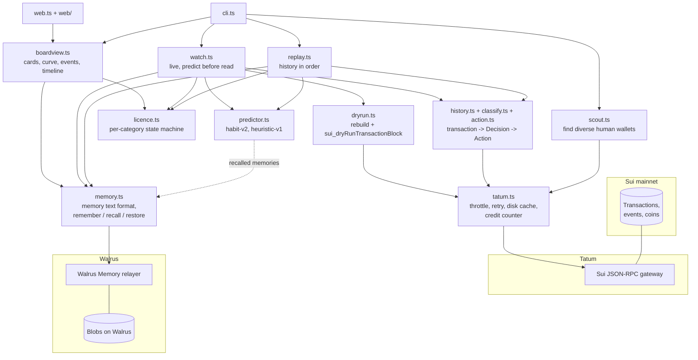

# Architecture

Shadowright is a small TypeScript program (Node 24+, no build step) with two entry points: the CLI
(`src/cli.ts`) and the read-only Licence Board server (`src/web.ts` + `web/`). Everything it knows
about a wallet comes from two services: **Tatum** (what happened on Sui) and **Walrus Memory**
(what the agent learned).

## One decision, step by step

1. **Context.** The previous decision of the user (an `Action`: category, venue or recipient,
   coin, amount bucket) and the time since it. Nothing about the decision being predicted.
2. **Recall** (`memory.ts`). Two Walrus Memory recalls with the same query, written in the
   memories' own words: the most similar memories and the most recent similar ones.
3. **Predict** (`predictor.ts`). `habit-v2` lets each recalled memory vote: same previous action,
   same session state, newer memories and lessons from past misses weigh in. Output: an action,
   a confidence and human-readable reasons.
4. **Observe** (`history.ts` via `tatum.ts`). The real transaction, normalised into a `Decision`
   and classified by explainable rules (`classify.ts`). In live mode (`watch.ts`) the prediction
   is stored with its timestamp before the transaction is read.
5. **Compare** (`action.ts`). Correct only if category, venue/recipient and coin match.
6. **Remember** (`memory.ts`). The episode becomes one memory: prose for semantic recall plus a
   `#sr1` trailer for lossless parsing. The agent waits until it is on Walrus and journals the
   blob id locally, so reruns continue instead of duplicating.
7. **Licence** (`licence.ts`). A pure state machine per category: `LOCKED` until 5 memories,
   `LICENSED` at 80% over the last 10, revoked by one miss, back only after 3 correct in a row. A
   miss counts against both the actual and the predicted category.
8. **Act?** If the predicted category was licensed, `dryrun.ts` rebuilds the equivalent
   transaction from the user's latest matching one and dry-runs it through Tatum. Nothing is ever
   signed or sent.

## Data and state

| Where | What | Can be rebuilt from |
| --- | --- | --- |
| Walrus Memory, namespace `shadowright-v1:<8 hex>` | Every episode (the agent's knowledge) | Itself: `restore` re-indexes from Walrus |
| `data/subjects.json` (git-ignored) | Subject names, addresses, default | The scout or the user |
| `data/subjects/<name>/` (git-ignored) | Backfilled history, journal of stored episodes, live-mode cursor | Tatum + Walrus Memory |
| `data/cache/` (git-ignored) | Stable Tatum responses | Tatum |
| `data/tatum-usage.json` (git-ignored) | Running credit total | - |

The board (`boardview.ts`) is computed from recalled memories only: licences are replayed from
the memories in time order with the same state machine, so a fresh client that restores the
namespace from Walrus shows exactly the same board.

## Testing

`npm test` runs the Node test runner over `test/*.test.ts`: classifier fixtures (one per
category), the licence state machine, memory format round-trips, predictors, replay and live mode
against the SDK's in-process `MemWalMock`, the Tatum client against a stubbed `fetch`, dry-run
helpers, scout filters, subjects and address masking. `npm run typecheck` runs `tsc --noEmit`.
No test touches the network.
